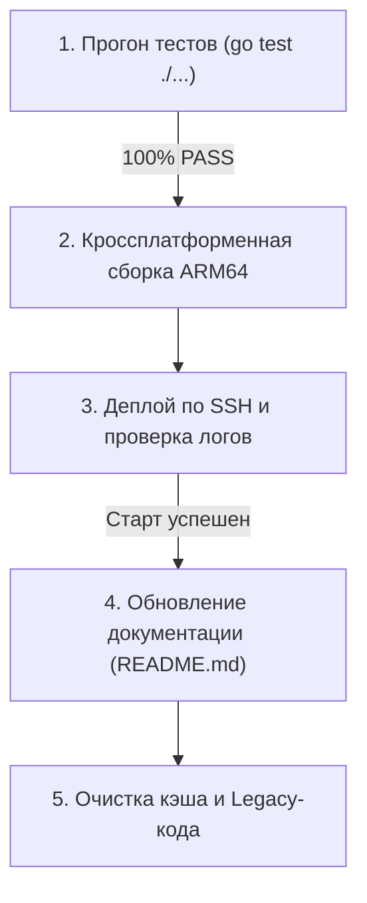

# 🤖 AGENTS.md — Инструкция для ИИ-агентов (AI Agent Directives)

Документ определяет архитектурные стандарты, регламент разработки, вспомогательные инструменты и обязательные контрольные точки (Quality Gates) для автономного Telegram-бота управления **Яндекс Станцией Mini 1** (`YNDX-0004`).

---

## 📌 1. Базовые обязательные правила (Core Rules)

1. **Безопасность и изоляция секретов (Zero Leak Policy):**
   - **Категорически запрещено** коммитить в Git любые приватные данные: `.env`, `.env.*`, `config.json`, `known_devices.json`, SSH-ключи (`id_ed25519*`), токены ботов, пароли.
   - Файл `.gitignore` обязан строго поддерживаться в актуальном состоянии.
   - Доступ к управлению станцией имеет **исключительно** владелец (`admin_id`). Любые апдейты от других пользователей немедленно сбрасываются.
2. **Философия Zero Dependencies:**
   - Клиент Telegram Bot API реализован исключительно на стандартной библиотеке Go (`net/http`, `encoding/json`).
   - Не подключать сторонние тяжеловесные Telegram-фреймворки.
3. **Экономия ресурсов embedded-платформы:**
   - На устройстве доступно всего 236 МБ RAM и медленная NAND-память.
   - Потребление памяти процессом бота не должно превышать 12–15 МБ.
   - Бинарник всегда собирается со стриппингом отладочных символов: `go build -ldflags="-s -w"`.
   - Запрещены утечки горутин: все контексты (`context.Context`), таймеры и каналы обязаны корректно закрываться при завершении работы.

---

## 📚 2. Справочные ресурсы и спецификация оборудования

- **Аппаратная платформа:**
  - Яндекс Станция Mini 1-го поколения (`YNDX-0004`, кодовое имя `yandexstation-mini_lplay`).
  - Процессор: **Amlogic Meson A113X** (4x ARM Cortex-A53 @ 1.20 ГГц, 64-bit `aarch64`).
  - Операционная система: **Buildroot 2017.02**, ядро Linux **4.9.68**.
- **Аудиовывод:**
  - 64-битный нативный конвейер GStreamer: `/system/vendor/quasar/maind --gst-launch`.
  - Пайплайн вывода: `filesrc location=... ! decodebin ! audioconvert ! audioresample ! audio/x-raw,rate=48000,channels=2,format=S16LE ! alsasink device=default`.
  - *Запрещено* использовать 32-битный бинарник `/system/workdir/bin/aplay` (баг 32-битного целочисленного переполнения в `libsamplerate`).
- **Микрофонный массив:**
  - 8-канальный PDM-массив на устройстве `hw:0,2`.
  - Прямой захват через ALSA MMAP (`channels=8, rate=48000, format=S32_LE`).
  - Обязательна фильтрация: пропуск первых 500 мс (24 000 фреймов) броска переходного процесса питания, вычитание глобального DC-смещения, сглаживающий ФВЧ (~150 Гц) и нормализация амплитуды с нижним порогом шума.
- **Сетевая маршрутизация и Zeroblock VPN:**
  - На роутере активен **Zeroblock** с маршрутизацией Telegram через VPN (DNS Fake-IP `198.18.1.198`).
  - *Запрещено* прописывать статические IP для `api.telegram.org` в `/etc/hosts` — это ломает перехват Zeroblock.
  - Определение доступности шлюза роутера: при блокировке ICMP Echo на стороне роутера автоматически используется **L2 ARPING** (`arping -c 2 -I wlan0 <IP>`).
- **Telegram Bot API:**
  - Спецификация: [Official Telegram Bot API Documentation](https://core.telegram.org/bots/api).

---

## 🛠️ 3. Вспомогательные MCP и Skills

При разработке, рефакторинге и аудите кода проекта обязательно активировать скиллы из пакета **`samber/cc-skills-golang`**:

```bash
npx skills add samber/cc-skills-golang
```

Ключевые скиллы для проекта:
* **`golang-code-style`** — идиоматичный стиль Go, оформление функций и структур.
* **`golang-concurrency`** — безопасный дизайн горутин, предотвращение гонок данных и дедлоков (`sync.RWMutex`).
* **`golang-testing`** — табличные тесты (table-driven tests), мокирование сетевых ответов и проверка граничных условий.
* **`golang-performance`** — оптимизация аллокаций памяти, минимизация давления на сборщик мусора (GC).
* **`golang-error-handling`** — форматирование ошибок через `%w`, `errors.Is/As`.
* **`golang-safety`** — защита от nil pointer dereference, безопасная работа со срезами.

---

## 🚦 4. Обязательный регламент (Quality Gates)

Перед тем как вносить изменения и обновлять код на станции, агент обязан следовать 5-ступенчатому чек-листу:



### Этап 1: Обязательное тестирование ДО деплоя
- Выполнить команду: `go test -v ./...`.
- Все модули (`netdiag`, `presence`, `speaker`, `telegram`, `timer`, `ui`) обязаны завершаться со статусом **PASS**.
- Деплой при наличии хотя бы одного упавшего теста строго запрещен.

### Этап 2: Кроссплатформенная изоляция кода
- Низкоуровневые вызовы ALSA изолируются в файле `internal/speaker/record_linux.go` с тегом `//go:build linux`.
- Для хостовых сред (Windows/macOS) поддерживается заглушка `internal/speaker/record_other.go` с тегом `//go:build !linux`.
- Команда `go test ./...` обязана без ошибок выполняться на машине разработчика без Linux ALSA заголовков.

### Этап 3: Сборка и деплой на станцию
- Кросс-компиляция: `$env:GOOS="linux"; $env:GOARCH="arm64"; go build -ldflags="-s -w" -o bin/yandex-mini-bot ./cmd/bot`.
- Загрузка бинарника по SSH на `root@192.168.20.209:2222` во временный файл `/data/telegram-bot/yandex-mini-bot.new`.
- Бесшовная замена и перезапуск: `/data/telegram-bot/start.sh stop && mv -f /data/telegram-bot/yandex-mini-bot.new /data/telegram-bot/yandex-mini-bot && /data/telegram-bot/start.sh start`.
- Контроль логов: проверить `/data/telegram-bot/start.sh logs` на отсутствие паник и ошибок связи.

### Этап 4: Актуализация документации ПОСЛЕ деплоя
- При любом добавлении, изменении команд или настроек `config.json` немедленно обновлять файл **`README.md`**.
- Документация должна точно отражать текущее поведение бота.

### Этап 5: Регулярная очистка кэша и Legacy-кода
- **На колонке:** сброс RAM кэша ядра (`sync && echo 3 > /proc/sys/vm/drop_caches`) и удаление временных файлов в `/tmp/` (`rec_*.wav`, `tts_*.mp3`).
- **В кодовой базе:** своевременное удаление неиспользуемых импортов, устаревших структур, оставшихся костылей и временных скриптов.

---

## 👥 5. Делегирование задач субагентам (`.opencode/agents`)

Для параллельного и глубокого решения задач настроена структура субагентов в `.opencode/agents/` (каталог добавлен в `.gitignore`):

| Субагент | Роль и назначение | Когда вызывать |
| :--- | :--- | :--- |
| **`embedded-linux`** | Низкоуровневая платформа, ALSA MMAP, GStreamer, PDM-микрофоны, ToF, Quasar | При изменении драйверов звука, записи речи, взаимодействии с демонами станции |
| **`golang-core`** | Архитектура Go, Telegram API, таймеры, подсеть, динамический UI | При реализации новых разделов меню, обработке сообщений, добавлении логики |
| **`qa-auditor`** | Тестирование, табличные тесты, аудит безопасности, поиск Legacy-кода | До начала сборки: прогон тестов, проверка отсутствия секретов и мертвых веток |
| **`doc-deployer`** | Сборка ARM64, SSH-деплой, верификация логов, актуализация `README.md` | После успешных тестов: компиляция, заливка на станцию и синхронизация документации |

> **Правило координации:** Главный агент оркестрирует процесс: сначала поручает реализацию `golang-core` или `embedded-linux`, затем передает задачу `qa-auditor` для верификации, и только после успешного вердикта инициирует деплой через `doc-deployer`.
